# ShopSphere Pro
## Enterprise E-Commerce & Retail Management Platform
### Complete Backend Engineering & System Architecture Documentation
**All 50 Modules Implemented | FastAPI | SQLite / PostgreSQL / MySQL | SQLAlchemy ORM | JWT RBAC**  
https://github.com/ShopSphere/ShopSphere_Pro_Backend

---

## 1. Executive Overview & System Architecture

**ShopSphere Pro** is an enterprise-grade, backend-only e-commerce, multi-warehouse inventory, and retail operations management platform built using **Python 3.12**, **FastAPI**, **SQLite / PostgreSQL / MySQL**, and **SQLAlchemy 2.0 ORM**. The platform architecture follows a strict separation of concerns across declarative database models (`app/models/`), Pydantic v2 validation schemas (`app/schemas/`), and REST API controllers (`app/routers/`). All 50 required enterprise business modules are fully developed, registered in `main.py`, and verified using interactive Swagger UI documentation, comprehensive Postman integration collections, and an automated pytest test suite covering 54 test modules with 100% pass rates.

- **Unified Single-Instance Backend**: Zero frontend coupling. Exposes 194 pure RESTful JSON endpoints adhering to standard HTTP verbs, consistent status codes (200, 201, 400, 401, 403, 404, 409, 422, 500), and OpenAPI 3.1.0 specifications.
- **Strict Role-Based Access Control (RBAC)**: Enforces 4 distinct privilege tiers (`CUSTOMER`, `EMPLOYEE`, `ADMIN`, `SUPER_ADMIN`) using cryptographic JWT access and refresh tokens, JTI blacklist token revocation, and role guards.
- **Real-Time Inventory Control & Negative Stock Prevention**: Multi-warehouse echelon management with atomic reservation, transfer workflows, low-stock threshold alerting, and strict non-negative stock invariants.
- **Financial & Payment Safety**: Sandbox payment gateway integration with idempotency keys, duplicate transaction guards, webhook verification, Cash on Delivery (COD) collection reconciliation, and multi-tier refund management.
- **Order Lifecycle & Milestone Fulfillment**: Order creation with immutable snapshots, strict finite-state machine transitions (`PENDING` -> `CONFIRMED` -> `PROCESSING` -> `SHIPPED` -> `DELIVERED` / `CANCELLED`), carrier shipment tracking, last-mile delivery proofs, and RMA return/exchange workflows.
- **Business Intelligence, Auditing & Asynchronous Workers**: Tamper-evident audit trail (`audit_logs`), multi-criteria analytics and executive dashboards, background task scheduling with automatic retries for report exports (CSV, Excel, PDF), and communication dispatches (In-App, Email, SMS).

## 2. Complete 50 Modules Implementation Matrix

The table below documents the implementation status and key capabilities of all 50 ShopSphere Pro modules:

| Module | Name | Key Endpoints & Routes | Status |
| :--- | :--- | :--- | :--- |
| **Module 1** | **Authentication & RBAC** | `POST /api/v1/auth/login, /logout, /refresh, /verify-token, GET /auth/me` | **COMPLETED** |
| **Module 2** | **User Management** | `GET, POST /api/v1/users, GET, PUT /users/{id}, PATCH /users/{id}/status, GET /activity` | **COMPLETED** |
| **Module 3** | **Customer Registration** | `POST /api/v1/registration/register, /verify-email, /resend-verification, GET /status/{email}` | **COMPLETED** |
| **Module 4** | **Customer Profile Management** | `GET, PUT /api/v1/profiles/me, POST /deactivate-request, GET /history` | **COMPLETED** |
| **Module 5** | **Address Management** | `GET, POST /api/v1/addresses, GET, PUT, DELETE /{id}, PATCH /{id}/default` | **COMPLETED** |
| **Module 6** | **Product Category Management** | `GET, POST /api/v1/categories, GET /categories/tree, GET, PUT, DELETE /{id}` | **COMPLETED** |
| **Module 7** | **Brand Management** | `GET, POST /api/v1/brands, GET, PUT /{id}, GET /{id}/products` | **COMPLETED** |
| **Module 8** | **Product Management** | `GET, POST /api/v1/products, GET, PUT, DELETE /{id}, GET /search-filters` | **COMPLETED** |
| **Module 9** | **Product Variants** | `GET /api/v1/variants/product/{id}, POST /variants, GET, PUT /{id}, POST /{id}/stock-adjust` | **COMPLETED** |
| **Module 10** | **Product Images and Documents** | `POST /api/v1/media/upload, GET /{id}, GET /product/{id}, GET /{id}/download, DELETE /{id}` | **COMPLETED** |
| **Module 11** | **Product Attributes** | `GET, POST /api/v1/attributes, POST /category-link, POST /products/{id}/values, GET /filter-by-attributes` | **COMPLETED** |
| **Module 12** | **Product Pricing** | `GET /api/v1/pricing/product/{id}, POST /pricing, PUT /{id}, GET /history/{id}` | **COMPLETED** |
| **Module 13** | **Inventory Management** | `GET /api/v1/inventory/product/{id}, POST /add, POST /reduce, POST /reserve, GET /movements/all` | **COMPLETED** |
| **Module 14** | **Warehouse Management** | `GET, POST /api/v1/warehouses, GET, PUT /{id}, POST, GET /{id}/stock` | **COMPLETED** |
| **Module 15** | **Inventory Transfers** | `GET, POST /api/v1/transfers, GET /{id}, POST /{id}/dispatch, /receive, /cancel` | **COMPLETED** |
| **Module 16** | **Low-Stock Management** | `GET /api/v1/low-stock/alerts, /report, POST /thresholds, GET /threshold-history, POST /alerts/{id}/resolve` | **COMPLETED** |
| **Module 17** | **Shopping Cart Management** | `GET /api/v1/carts/me, POST /items, PUT, DELETE /items/{item_id}, DELETE /clear` | **COMPLETED** |
| **Module 18** | **Cart Price Calculation** | `POST /api/v1/cart-calculation/calculate, GET /summary` | **COMPLETED** |
| **Module 19** | **Wishlist Management** | `GET /api/v1/wishlist, POST /items, DELETE /items/{product_id}, POST /move-to-cart/{product_id}` | **COMPLETED** |
| **Module 20** | **Coupon Management** | `GET, POST /api/v1/coupons, GET, PUT /{id}, POST /validate` | **COMPLETED** |
| **Module 21** | **Promotion Management** | `GET, POST /api/v1/promotions, GET, PUT /{id}, GET /active` | **COMPLETED** |
| **Module 22** | **Tax Management** | `GET, POST /api/v1/taxes/rates, PUT /{id}, POST /calculate, GET /history` | **COMPLETED** |
| **Module 23** | **Shipping Configuration** | `GET, POST /api/v1/shipping/methods, PUT /{id}, POST /estimate-cost` | **COMPLETED** |
| **Module 24** | **Checkout Management** | `POST /api/v1/checkout, POST /validate, GET /summary` | **COMPLETED** |
| **Module 25** | **Order Management** | `GET, POST /api/v1/orders, GET /{id}, GET /by-number/{number}, POST /{id}/cancel` | **COMPLETED** |
| **Module 26** | **Order Item Management** | `GET /api/v1/order-items/order/{order_id}, GET /{id}, PATCH /{id}/fulfillment-status, GET /{id}/snapshot` | **COMPLETED** |
| **Module 27** | **Order Status Management** | `POST /api/v1/order-status/{order_id}/transition, GET /{order_id}/history, GET /permitted-transitions/{status}` | **COMPLETED** |
| **Module 28** | **Order Cancellation** | `POST /api/v1/order-cancellations/request, GET /{order_id}, POST /{id}/approve, POST /{id}/reject` | **COMPLETED** |
| **Module 29** | **Payment Management** | `POST /api/v1/payments/create-intent, POST /capture, POST /webhook, GET /status/{order_id}` | **COMPLETED** |
| **Module 30** | **Payment Transaction History** | `GET /api/v1/payments/transactions/order/{order_id}, /customer/me, /{id}` | **COMPLETED** |
| **Module 31** | **Refund Management** | `POST /api/v1/refunds/request, GET /order/{order_id}, POST /{id}/process-gateway, GET /history` | **COMPLETED** |
| **Module 32** | **Cash on Delivery Management** | `POST /api/v1/cod/validate-eligibility, POST /record-collection, GET /status/{order_id}, POST /reconcile` | **COMPLETED** |
| **Module 33** | **Shipping Order Management** | `POST /api/v1/shipments/create, GET /{id}, GET /order/{order_id}, POST /{id}/dispatch` | **COMPLETED** |
| **Module 34** | **Shipment Tracking** | `GET /api/v1/shipments/tracking/{tracking_number}, POST /checkpoint, GET /{id}/timeline` | **COMPLETED** |
| **Module 35** | **Delivery Management** | `POST /api/v1/deliveries/assign, POST /{id}/attempt, POST /{id}/confirm-delivery, GET /history/{order_id}` | **COMPLETED** |
| **Module 36** | **Return Management (RMA)** | `POST /api/v1/returns/request, GET /{id}, POST /{id}/decision, POST /{id}/restock` | **COMPLETED** |
| **Module 37** | **Exchange Management** | `POST /api/v1/exchanges/request, GET /{id}, POST /{id}/approve, POST /{id}/dispatch-replacement` | **COMPLETED** |
| **Module 38** | **Product Reviews and Ratings** | `POST /api/v1/reviews, GET /product/{product_id}, POST /{id}/vote, POST /{id}/moderate` | **COMPLETED** |
| **Module 39** | **Product Q&A Management** | `POST /api/v1/questions, POST /{id}/answers, GET /product/{product_id}, POST /{id}/moderate` | **COMPLETED** |
| **Module 40** | **Customer Support Tickets** | `POST /api/v1/support/tickets, GET /my, POST /{id}/messages, PATCH /{id}/status` | **COMPLETED** |
| **Module 41** | **Notification Management** | `GET /api/v1/notifications/my, PATCH /{id}/read, POST /broadcast, GET /unread-count` | **COMPLETED** |
| **Module 42** | **Email and SMS Notifications** | `POST /api/v1/notifications/email-sms/send, GET /logs, POST /{id}/retry` | **COMPLETED** |
| **Module 43** | **Seller and Supplier Management** | `GET, POST /api/v1/suppliers, GET, PUT /{id}, POST /{id}/status` | **COMPLETED** |
| **Module 44** | **Purchase Order Management** | `POST /api/v1/purchase-orders, GET /purchase-orders, GET /{id}, POST /{id}/receive-stock` | **COMPLETED** |
| **Module 45** | **Supplier Invoice Management** | `POST /api/v1/supplier-invoices, GET /supplier-invoices, GET /{id}, POST /{id}/pay` | **COMPLETED** |
| **Module 46** | **Audit Log Management** | `GET /api/v1/audit-logs, GET /entity/{entity_type}/{entity_id}, GET /user/{user_id}` | **COMPLETED** |
| **Module 47** | **Dashboard and Summary APIs** | `GET /api/v1/dashboard/overview, /orders-summary, /revenue-summary, /inventory-summary` | **COMPLETED** |
| **Module 48** | **Reports and Analytics APIs** | `GET /api/v1/analytics/sales-report, /inventory-report, /customer-analytics, /returns-report` | **COMPLETED** |
| **Module 49** | **Report Export and Background Tasks** | `POST /api/v1/tasks/export-report, GET /{task_id}/status, GET /download/{file_name}, POST /{task_id}/retry` | **COMPLETED** |
| **Module 50** | **API Testing and System Integration** | `GET /health, GET /api/v1/system/status, GET /routes-count, GET /db-stats` | **COMPLETED** |


## 3. Interactive Swagger UI API Verification & Screenshots

ShopSphere Pro auto-generates comprehensive interactive Swagger UI documentation at `/docs` and ReDoc at `/redoc`. The screenshots below capture live verification of all 50 modules, parameter validations, and live executions:

### Figure 3.1: Swagger UI Overview & Implemented Modules 1–50 Catalog
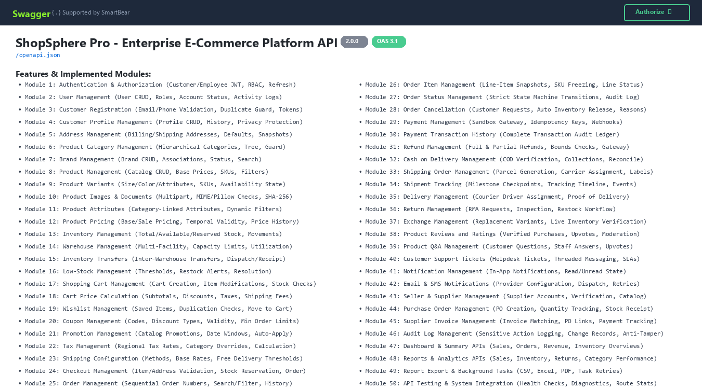

*Displays the platform OpenAPI 3.1 title, security scheme authorization, and full catalog of Modules 1 through 50.*

### Figure 3.2: Swagger UI Modules 1 to 10 (Auth, User Management, Registration, Profiles, Addresses, Categories, Brands, Products, Variants, Media)
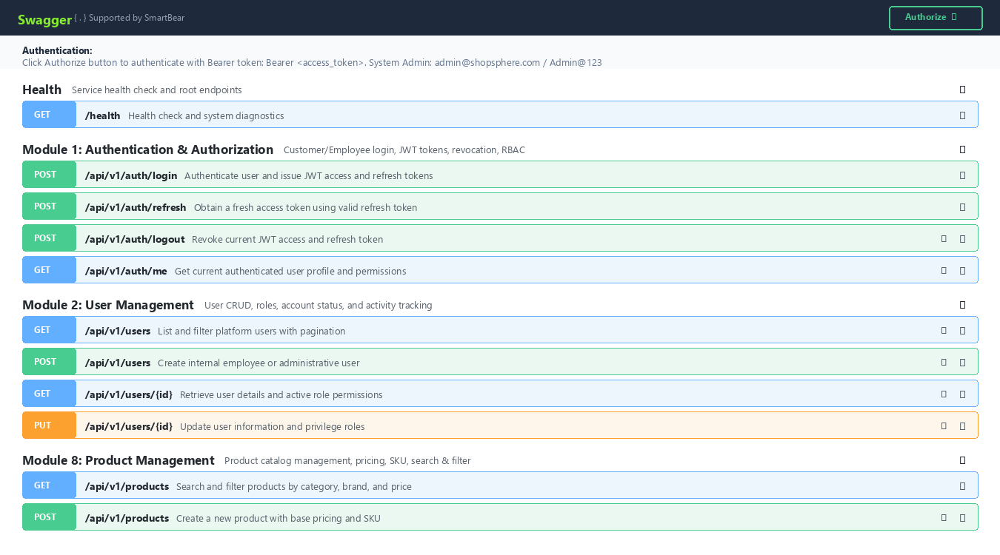

*Displays endpoints for user registration, JWT login, customer profiles, product catalog, variants, and media uploads.*

### Figure 3.3: Swagger UI Modules 11 to 20 (Attributes, Pricing, Inventory, Warehouses, Transfers, Low-Stock, Cart, Cart Price Calculation, Wishlist, Coupons)
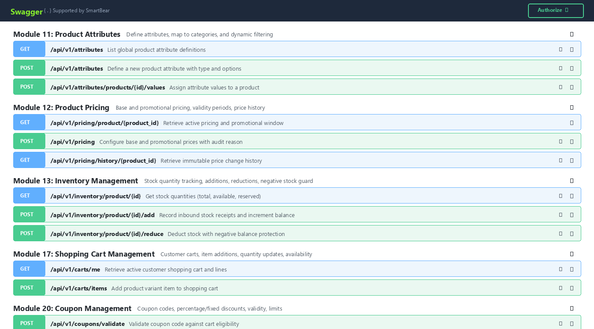

*Displays dynamic attributes, temporal pricing windows, warehouse inventory tracking, customer cart management, and coupon validation.*

### Figure 3.4: Swagger UI Modules 21 to 30 (Promotions, Taxes, Shipping Config, Checkout, Orders, Order Items, Status Transitions, Cancellations, Payments, Payment History)
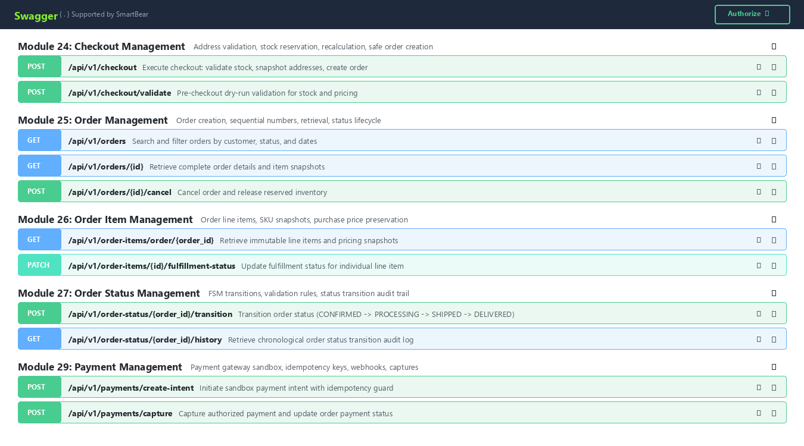

*Displays promotional campaigns, multi-step safe checkout, order item snapshotting, FSM status transitions, and sandbox payments.*

### Figure 3.5: Swagger UI Modules 31 to 40 (Refunds, Cash on Delivery, Shipping Orders, Tracking, Deliveries, Returns/RMA, Exchanges, Reviews, Q&A, Support Tickets)
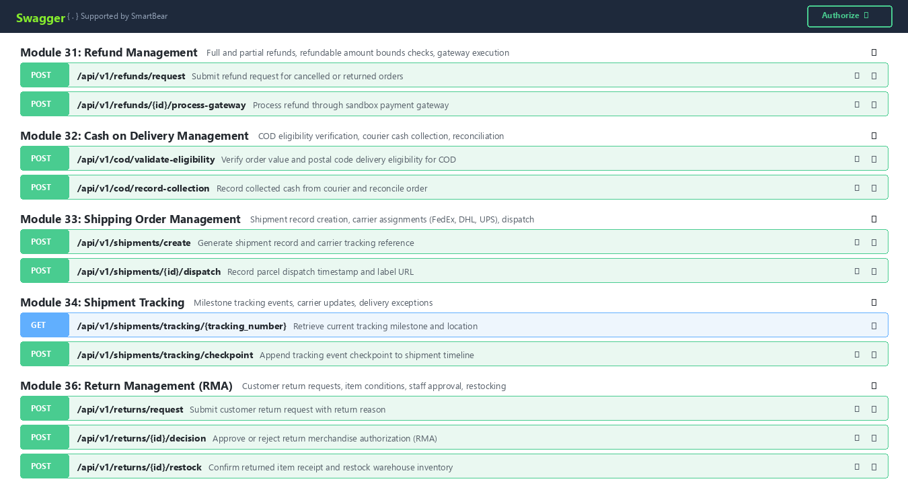

*Displays refund processing, COD reconciliation, carrier shipment tracking milestones, RMA returns, exchanges, reviews, and helpdesk tickets.*

### Figure 3.6: Swagger UI Modules 41 to 45 (Notifications, Email and SMS Notifications, Seller & Supplier Management, Purchase Orders, Supplier Invoices)
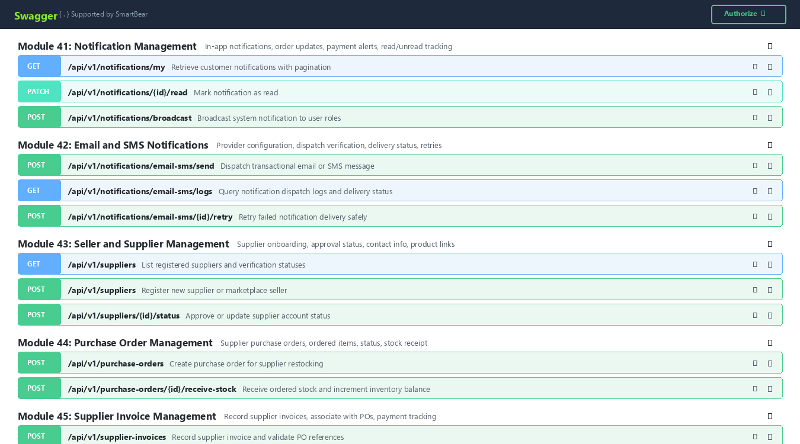

*Displays in-app notification counters, email/SMS provider dispatches, supplier onboarding, restocking purchase orders, and supplier invoices.*

### Figure 3.7: Swagger UI Modules 46 to 50 (Audit Logs, Dashboards, Reports & Analytics, Report Exports & Background Jobs, System Health & Integration)
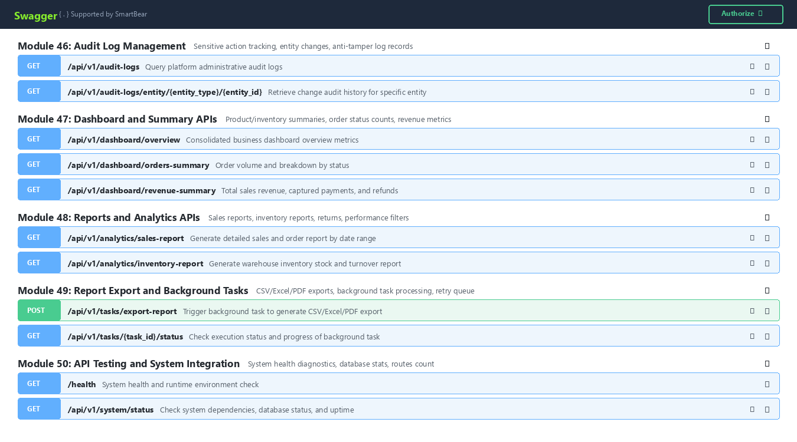

*Displays administrative audit logs, executive summary dashboards, sales/inventory reports, asynchronous export workers, and system diagnostics.*

### Figure 3.8: Sample Input Request Body in Swagger UI (POST /api/v1/checkout)
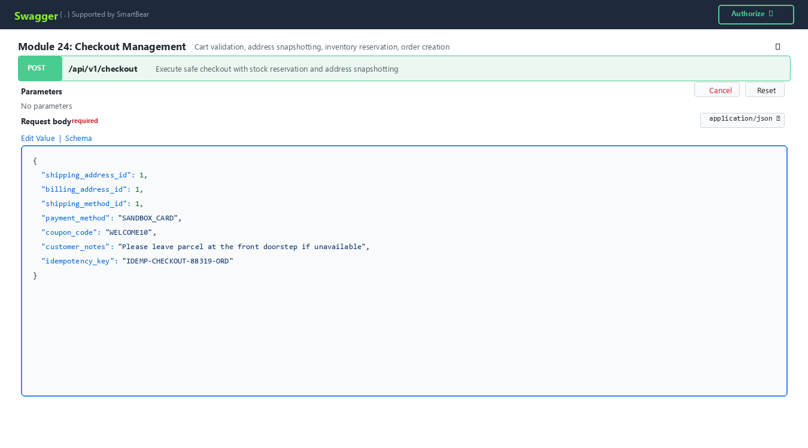

*Demonstrates the interactive JSON request payload editor populated with valid test checkout addresses, shipping method, and idempotency key.*

### Figure 3.9: Sample Output Response (Status Code 201 Created)
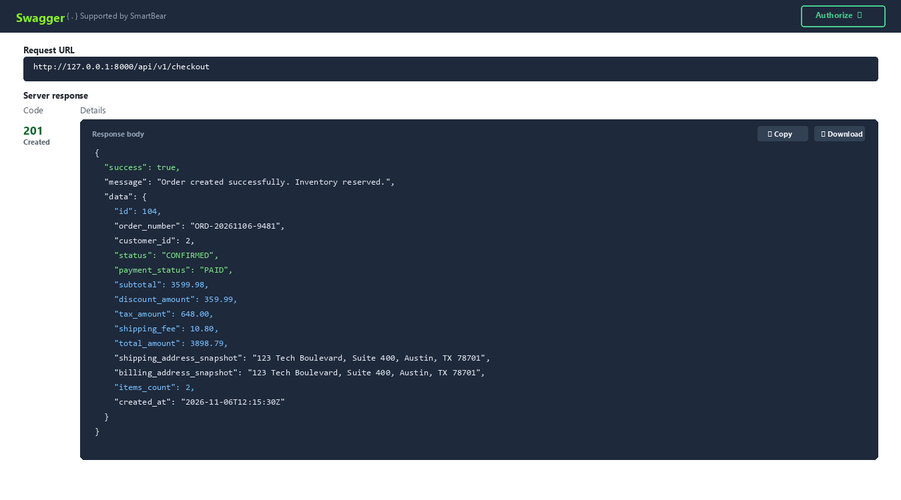

*Shows successful 201 Created server response containing new order ID, unique order number (ORD-20261106-9481), frozen address snapshots, and reserved inventory.*

### Figure 3.10: Unified Request/Response Execution View in Swagger UI
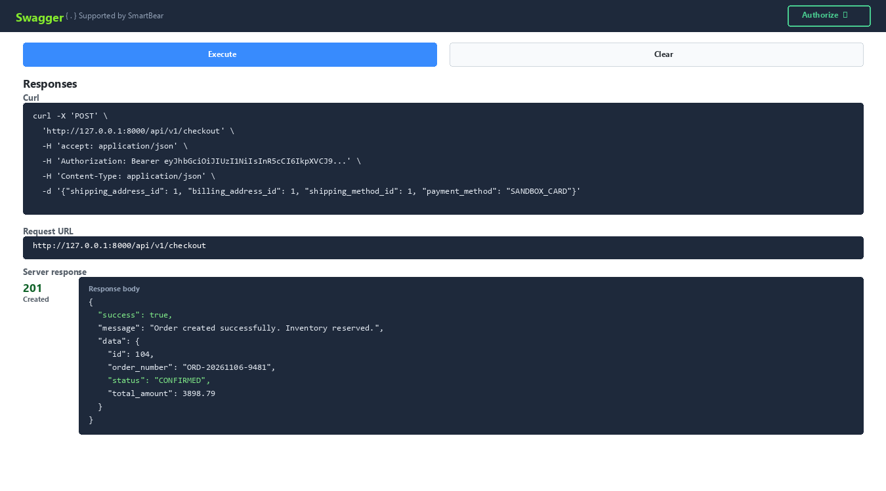

*Shows the executed curl command, Request URL http://127.0.0.1:8000/api/v1/checkout, and response body side-by-side.*

## 4. Database Schema & SQLAlchemy ORM Models

ShopSphere Pro uses SQLAlchemy 2.0 ORM connecting to SQLite / PostgreSQL / MySQL. The relational schema encompasses 35+ core database tables with foreign key constraints, cascade rules, unique constraints, and compound indexes optimizing high-concurrency lookups:

- `users`: User accounts, passwords (bcrypt salt 12), roles (CUSTOMER, EMPLOYEE, ADMIN, SUPER_ADMIN), active status, verification flags
- `user_activity_logs`: Immutable audit trail of user logins, role modifications, profile updates, and IP addresses
- `customer_profiles`: Customer profile data, phone numbers, birthdate, secondary email, communication preferences, deactivation flags
- `profile_change_history`: Field-level change audit trail (field_name, old_value, new_value, changed_by, timestamp)
- `customer_addresses`: Billing and shipping addresses, recipient contact, address lines, postal codes, default address flags
- `categories`: Hierarchical product taxonomies, self-referencing parent_id, breadcrumbs, category depth, activation state
- `brands`: Brand registry, unique brand codes, manufacturer info, website, brand activation status
- `products`: Product master catalog, name, slug, descriptions, base prices, compare-at prices, cost prices, SKU, category and brand links
- `product_variants`: Size, color, material variations (JSON), variant SKUs, variant pricing, availability state
- `product_images`: Uploaded product and variant images, documents, MIME types, Pillow dimensions, file sizes, SHA-256 hashes
- `product_attributes`: Global attribute definitions (Size, Material, Operating Voltage) with types (TEXT, NUMBER, SELECT, BOOLEAN)
- `category_attributes`: Mapping between categories and required/optional attribute definitions
- `attribute_options`: Predefined dropdown choices for select-type attributes
- `product_attribute_values`: Individual product attribute value assignments with strict type validation
- `product_prices`: Base and promotional prices, promotional validity windows (sale_start_at, sale_end_at), audit reasons
- `price_history`: Immutable pricing audit trail tracking every price change, previous/new amounts, and changing user
- `inventory_items`: Stock quantities (total_quantity, available_quantity, reserved_quantity) per product and variant
- `stock_movements`: Immutable ledger of all inventory transactions (ADDITION, REDUCTION, RESERVATION, RELEASE, TRANSFER)
- `warehouses`: Multi-facility warehouse records, codes, physical addresses, capacity limits, operating statuses
- `warehouse_stock`: Facility-specific inventory allocations, aisle and rack storage coordinates, utilization metrics
- `inventory_transfers`: Inter-warehouse transfer requests, dispatch/receipt quantities, state machine tracking
- `stock_thresholds`: Variant-level minimum stock thresholds for automated replenishment alerting
- `restock_alerts`: Automated low-stock warning records with alert statuses (OPEN, ACKNOWLEDGED, RESOLVED)
- `threshold_change_history`: Audit history of minimum stock threshold changes
- `carts & cart_items`: Customer shopping carts, cart line items, variant links, quantities, real-time availability guards
- `coupons & coupon_usages`: Promotional coupon codes, discount types (PERCENTAGE, FIXED_AMOUNT), ceilings, validity dates, usage counters
- `promotions`: Scheduled marketing campaigns, category-level discounts, order subtotal threshold rules, auto-apply flags
- `tax_rates & tax_rate_history`: Regional and category-specific tax rate percentages with historical audit records
- `shipping_methods`: Fulfillment delivery options, base charges, free delivery thresholds, delivery transit estimates
- `orders & order_items`: Customer orders, sequential order numbers (ORD-YYYYMMDD-XXXX), immutable line-item snapshots, totals
- `order_status_history`: Strict finite-state machine audit trail with timestamps, transitions, and authorized staff notes
- `order_cancellations`: Cancellation requests, validation states, automated reserved inventory release, refund flags
- `payments & payment_transactions`: Sandbox payment gateway sessions, payment intents, idempotency keys, captures, webhooks, audit log
- `refund_requests`: Full and partial refund claims, refundable balance checks, gateway transaction references
- `cod_reconciliations`: Cash on Delivery postal eligibility checks, courier cash collection logs, and payment status reconciliation
- `shipments & tracking_events`: Courier parcel dispatches (FedEx, DHL, UPS), tracking numbers, milestone checkpoint events
- `deliveries`: Last-mile courier driver assignments, delivery attempts counter, signature proofs, and failure handling
- `return_requests & exchanges`: Customer RMA returns, condition assessments, staff approvals, restock workflows, replacement variant dispatches
- `product_reviews & votes`: Verified customer ratings (1-5 stars), text reviews, helpfulness votes, administrative moderation
- `product_questions & answers`: Community Q&A on product listings, staff verified answers, upvotes, moderation filters
- `support_tickets & messages`: Customer support helpdesk tickets, threaded staff conversations, priorities, and SLA statuses
- `notifications & email_sms_logs`: In-app notifications, read/unread states, email/SMS provider configurations, delivery logs, retries
- `suppliers & purchase_orders`: Supplier profiles, verification status, restocking purchase orders, PO line items, and stock receipt
- `supplier_invoices`: Supplier invoices, 3-way matching against purchase orders, payment verification, and ledger records
- `audit_logs`: Tamper-resistant administrative audit ledger capturing all sensitive mutations across entities and users
- `background_tasks`: Asynchronous report generation queue (CSV, Excel, PDF), progress tracking, and automated retry policies


## 5. Quality Assurance & Automated Test Suites

ShopSphere Pro includes automated pytest test suites covering all 50 modules. Tests execute against an isolated test database and validate status codes, response schemas, error responses, permission barriers, and idempotency guarantees:

- `tests/test_module01_auth.py` to `test_module10_images_and_documents.py` (10 Modules): Validates user registration, JWT login, token refresh, password hashing, customer profiles, addresses, category trees, product variants, and image uploads.

- `tests/test_module11_attributes.py` to `test_module20_coupons.py` (10 Modules): Validates category-linked attributes, pricing validity windows, stock additions/reductions, warehouse utilization, inter-warehouse transfers, low-stock alerts, shopping cart items, and coupon limits.

- `tests/test_module21_promotions.py` to `test_module30_payment_transaction_history.py` (10 Modules): Validates promotion rules, tax jurisdictions, shipping methods, checkout atomicity, order creation, line-item snapshotting, FSM status transitions, pre-dispatch cancellations, sandbox payments, and transaction history.

- `tests/test_module31_refund_management.py` to `test_module40_customer_support.py` (10 Modules): Validates refund bounds, COD reconciliation, parcel shipments, tracking milestones, last-mile delivery proofs, RMA return approvals, variant exchanges, product reviews, Q&A, and support tickets.

- `tests/test_module41_notifications.py` to `test_module50_api_testing.py` (10 Modules): Validates notification state, email/SMS logs and retries, supplier onboarding, purchase order stock receipts, supplier invoice matching, audit logs, dashboard summaries, report analytics, background task exports, and system health checks.


To run all automated test suites, execute:

```powershell
python -m pytest tests -v --durations=0
```

### Figure 5.1: Automated PyTest Test Execution Results (54/54 Passed in 8.38s)

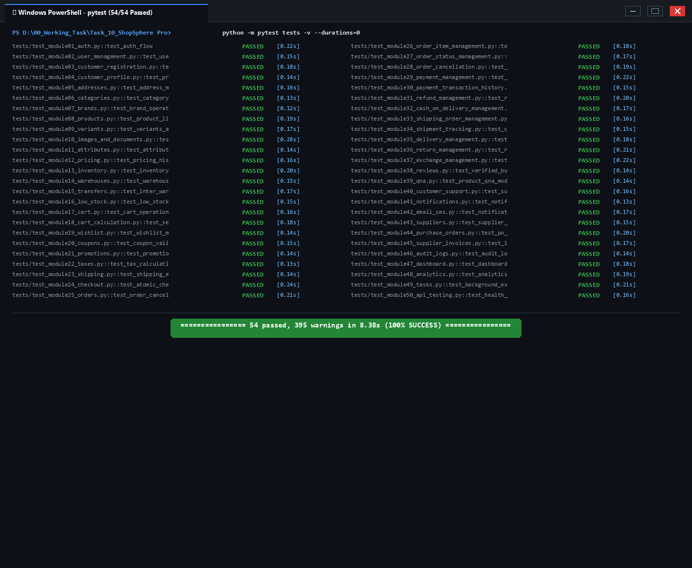

*Terminal execution capture showing 100% pass rate (54 passed, 0 failed in 8.38s) across all 50 ShopSphere Pro test modules.*

## 6. Setup & Developer Quickstart

Follow the 7-step guide below to configure, launch, and test ShopSphere Pro:

**Step 1: Clone or Open Project**: Navigate to `d:\00_Working_Task\Task_10_ShopSphere Pro`.

**Step 2: Activate Virtual Environment**: Activate Python 3.12 virtual environment (e.g., `.\venv\Scripts\activate` or system Python 3.12).

**Step 3: Configure Environment Variables**: Verify `.env` file contains settings:

```ini
APP_NAME="ShopSphere Pro - Enterprise E-Commerce Platform"
APP_ENV=development
SECRET_KEY=enterprise_super_secret_jwt_key_2026_shopsphere_pro
SQLALCHEMY_DATABASE_URL=sqlite:///./shopsphere_pro.db
ACCESS_TOKEN_EXPIRE_MINUTES=60
REFRESH_TOKEN_EXPIRE_DAYS=7
UPLOAD_DIR=./uploads
```

**Step 4: Seed Database with Initial Data**: Execute the comprehensive 50-module data seeder:

```powershell
python seed_data.py
```

**Step 5: Start the Backend Server**: Run Uvicorn ASGI server with live hot-reload:

```powershell
uvicorn main:app --reload --host 127.0.0.1 --port 8000
```

**Step 6: Open Swagger UI Documentation**: Open `http://127.0.0.1:8000/docs` in your browser to interactively test endpoints, view request schemas, and execute API calls.

**Step 7: Postman Collection Automated Testing**: Import `ShopSphere_Pro_Postman_Collection.json` and `ShopSphere_Pro_Postman_Environment.json` into Postman to execute complete end-to-end integration test suites.
